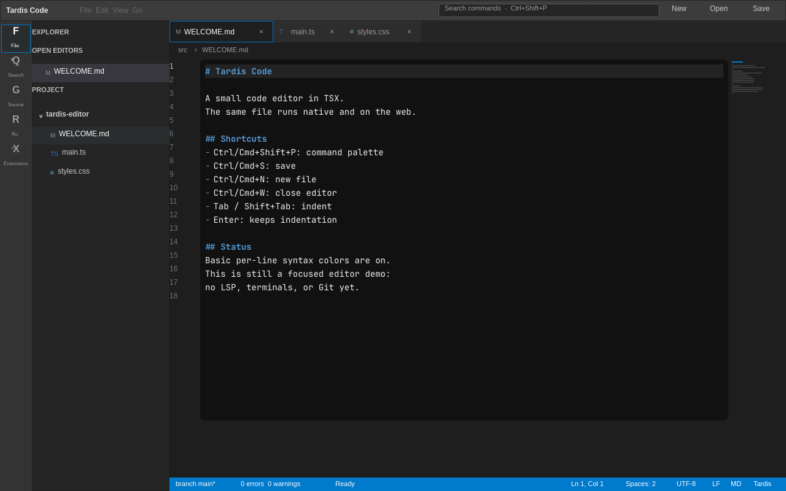
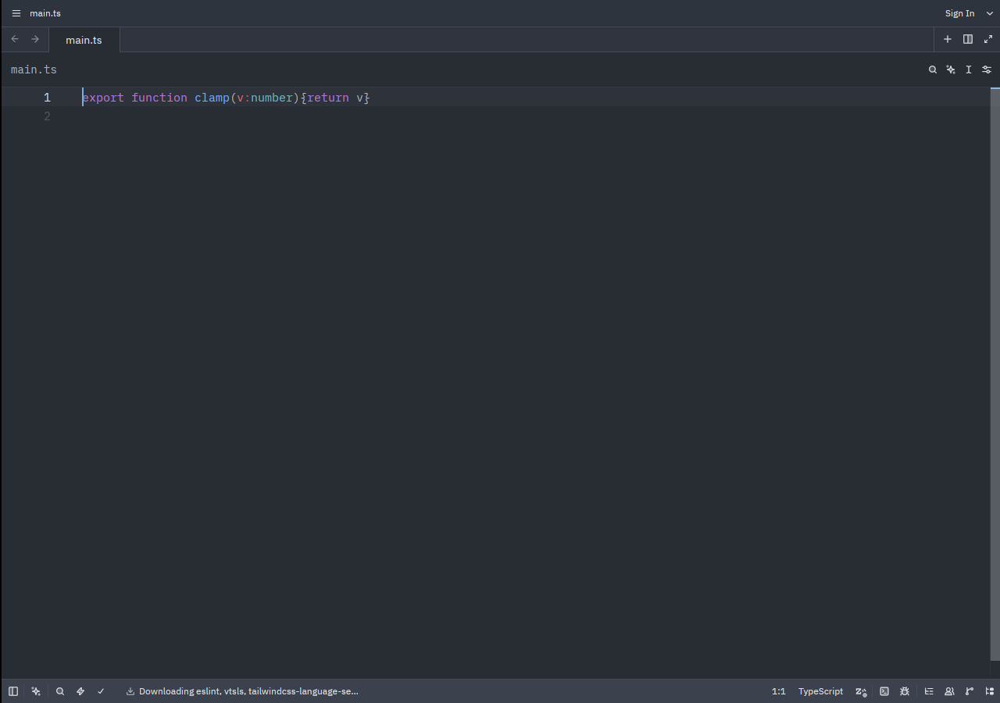

# Editor comparison: Tardis Code vs Zed

Both apps were run on the same machine under Xvfb with software rendering
(Tardis uses its CPU rasterizer; Zed uses llvmpipe via `ZED_ALLOW_EMULATED_GPU=1`).
Zed 1.30.2 is the official Linux build. Tardis Code is `examples/editor`.




## Measured

| Metric | Tardis Code | Zed 1.30.2 |
|---|---:|---:|
| Startup to first changed pixels (median of 3) | **410 ms** | 624 ms |
| Resident memory after 8 s (median of 3) | **45.5 MiB** | 363 MiB |
| Runtime executable | **10.5 MB** | 220 MB |
| Installed app/bundle | **10.6 MB** (binary + 93 KB app bundle) | 229 MB |
| Runs on web | **yes, same TSX file** | no (desktop only) |

Raw startup samples: Tardis 410 / 432 / 400 ms; Zed 624 / 626 / 589 ms.
RSS samples: Tardis 46596 / 46568 / 46096 KiB; Zed 370736 / 379360 / 371812 KiB.
Method: `bench/measure-startup.sh` (Xvfb pixel diff, first 200 changed pixels),
same 1024x768 screen, warm user profiles, three runs each. RSS is the process
tree sum after 8 seconds. Zed was opened on the same TypeScript sample file.

These numbers measure startup and memory, not typing latency or large-file
scrolling. No low-latency input instrumentation was available for Zed, so a
typing-latency claim is deliberately not made.

## Feature comparison

| Area | Tardis Code | Zed |
|---|---|---|
| Editing, selection, multiline, IME | yes | yes |
| Tabs, explorer, breadcrumbs, status bar | yes | yes |
| Command palette | yes (Ctrl/Cmd+Shift+P) | yes |
| Minimap | simple line map | full scaled minimap |
| Syntax highlighting | basic per-line tokenizer | tree-sitter, many languages |
| LSP, diagnostics, completions | **no** | yes |
| Multi-cursor, find/replace | **no** | yes |
| Git integration, terminal, collaboration | **no** | yes |
| Themes/extensions | one dark theme | large theme/extension ecosystem |
| Native + web from one file | **yes** | desktop only |

## Honest reading

Zed is a mature IDE and wins on features by a wide margin. Tardis Code wins on
startup, memory, distribution size, and running the same TSX app on the web.
Those are the axes measured here. The editor intentionally reports "no syntax
highlighting, LSP, terminals, or Git" in its own welcome file.

To reproduce:

```sh
npm run build
node dist/bin/tardis.js build examples/editor/app.tsx --out /tmp/editor-app.js
bash bench/measure-startup.sh 40 env -u WAYLAND_DISPLAY WINIT_UNIX_BACKEND=x11 \
  native/target/release/tardis-native --bundle /tmp/editor-app.js --width 1024 --height 768
node dist/bin/tardis.js run examples/editor/app.tsx --width 1280 --height 800
```
