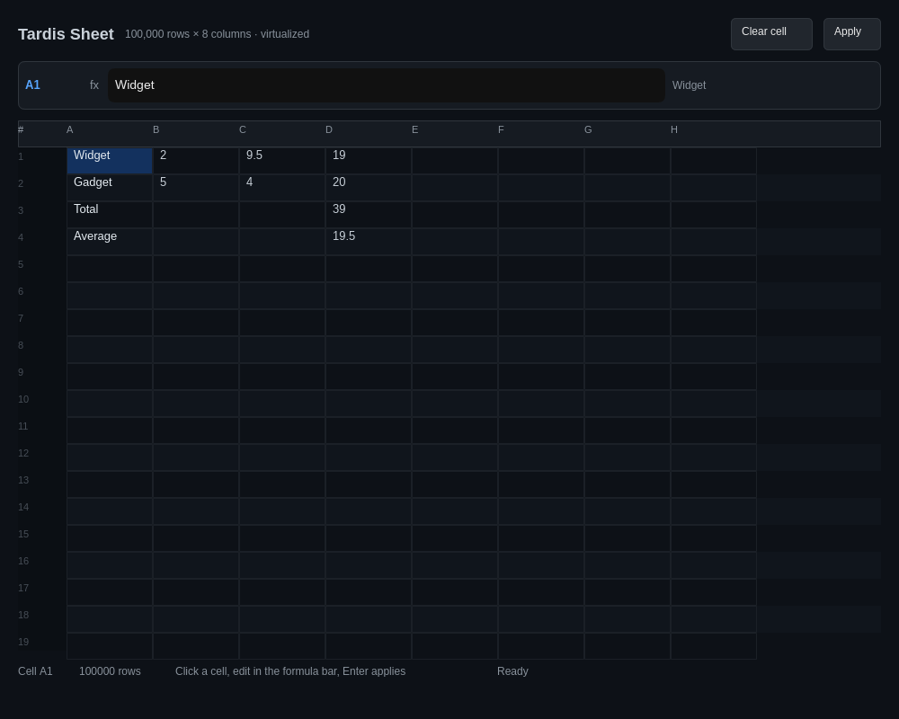

# 100k-row spreadsheet comparison

`examples/spreadsheet` is a Tardis Sheet clone with a 100,000 × 8 virtualized
grid, cell selection, a formula bar, and SUM/AVERAGE/MIN/MAX + arithmetic
formulas. `bench/web-frame/dioxus-sheet` is the Dioxus 0.6.3 rendering baseline:
the same virtualized 100,000 × 8 grid, with 24 mounted rows.



## Frame comparison

Chrome 155 headless, 1000×800, virtualized scrolling: every frame advances
8 rows, waits for `requestAnimationFrame`, and records the interval. Three
alternating rounds; median reported. Source: `bench/sheet-frame/`; raw values:
`bench/sheet-frame/results.json`.

| App | Mean frame | p50 | p95 | Dropped (>16.7 ms) | Effective FPS |
|---|---:|---:|---:|---:|---:|
| Tardis Sheet (100k rows) | 16.61 ms | 16.7 ms | **17.5 ms** | 54/120 | **60.2** |
| Dioxus baseline (100k rows) | 16.57 ms | 16.7 ms | **17.0 ms** | 51/120 | **60.3** |

The result is a tie within measurement noise: Dioxus is 0.2% ahead on mean and
0.5 ms ahead on p95. Both hold vsync because only the visible window is mounted.
This is the correct production shape for 100k rows; a fully mounted grid would
not hold 60 fps in either framework.

The Dioxus app is a rendering baseline, not a feature clone: it does not have
the Tardis formula engine, formula bar, or cell editing. The comparison isolates
the virtualized grid rendering path.

## Tardis sheet details

- 100,000 rows × 8 columns, row height 30, overscan 2.
- Sparse cell storage; seed rows demonstrate arithmetic and range formulas.
- `A1` style references, `=SUM(D1:D2)`, `=AVERAGE(D1:D2)`, cycle and syntax
  errors (`#CYCLE!`, `#ERROR!`).
- Formula parser tests: `test/examples/spreadsheet-formula.test.ts`.
- Native screenshot: `tardis screenshot examples/spreadsheet/app.tsx`.

Reproduce:

```sh
./bench/sheet-frame/build.sh
node bench/sheet-frame/run.mjs
```
